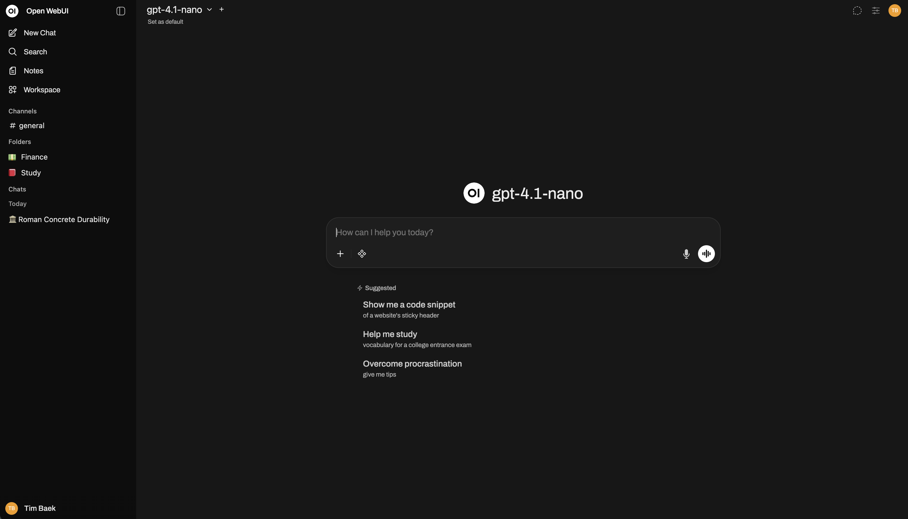

# CASTAPRIVA

> **CASTAPRIVA is a rebranded fork of [Open WebUI](https://github.com/open-webui/open-webui)** — a self-hosted AI platform that's extensible, feature-rich, and offline-capable, with support for Ollama and OpenAI-compatible APIs.

Built by **CASTASOFT** on top of Open WebUI. Upstream attribution retained per `LICENSE` and `LICENSE_HISTORY`.

Passionate about open-source AI? [Join our team →](https://careers.openwebui.com/)



> [!TIP]  
> **Looking for an [Enterprise Plan](https://docs.openwebui.com/enterprise)?** – **[Speak with Our Sales Team Today!](https://docs.openwebui.com/enterprise)**

For more information, be sure to check out our [Open WebUI Documentation](https://docs.openwebui.com/).

## Key Features of Open WebUI ⭐

- 🚀 **Effortless Setup**: Install seamlessly via pip, uv, Docker, or Kubernetes (kubectl, kustomize, or helm), with `:ollama` and `:cuda` tagged images available for container deployments.

- 🤝 **Broad Model & API Integration**: Connect any OpenAI-compatible API alongside local Ollama models. Point the API URL at **LMStudio, GroqCloud, Mistral, OpenRouter, vLLM, and more** to mix and match providers freely.

- 🔐 **Granular RBAC & User Groups**: Administrators define detailed roles, groups, and permissions, giving each user exactly the access they need. Secure by default, with tailored experiences per group.

- 🧩 **Plugin Support**: Extend Open WebUI with **Filters**, **Actions**, **Pipes**, **Tools**, and **Skills**. Connect external services through **MCP**, **MCPO**, and **OpenAPI tool servers**. Build custom integrations, rate limits, approval flows, data connections, and more.

- 🤖 **Models & Agents**: Wrap any base model with custom instructions, tools, and knowledge to build specialized agents. Supports dynamic variables, per-user/group access control, and community preset imports via [Open WebUI Community](https://openwebui.com/).

- ⚡ **Agentic Execution with [Open Terminal](https://github.com/open-webui/open-terminal)**: Give your agents a terminal and filesystem to carry out multi-step tasks. Let them analyze data, run scripts, fix errors, and produce files directly in chat. Scale to teams with **[Terminals (Enterprise)](https://github.com/open-webui/terminals)** for per-user isolated environments, resource limits, and automatic lifecycle management.

- 📝 **Notes**: A dedicated workspace for content outside conversations. Draft with a rich editor, use AI to rewrite selected text, and attach notes to any chat for full-context injection.

- 📢 **Channels**: Real-time shared spaces where your team and AI models collaborate in one timeline. Tag models to draft or critique, with threads, reactions, pins, and access control.

- 🧠 **Persistent Memory**: The AI remembers facts about you across conversations, carrying context from one chat to the next.

- ✅ **Live Workflow & Message Flow**: Watch the AI build and work through checklists in real time. Queue messages while the AI is still responding; they send automatically when it's ready.

- 📅 **Calendar & AI Scheduling**: Built-in personal and shared calendars with month/week/day views, recurring events, color coding, attendees, and reminders. Models manage your schedule conversationally through native function calling.

- ⏱️ **Automations**: Schedule prompts to run on recurring schedules, with runs surfaced on your calendar and each completed run linking back to the chat it produced.

- 📱 **Responsive Design & PWA**: Seamless experience across desktop, laptop, and mobile, with a Progressive Web App for native app-like feel and offline access on localhost.

- ✒️🔢 **Full Markdown and LaTeX Support**: Comprehensive Markdown and LaTeX capabilities for enriched interaction.

- 🎤📹 **Hands-Free Voice/Video Call**: Integrated voice and video calls with multiple Speech-to-Text providers (Local Whisper, OpenAI, Deepgram, Azure) and Text-to-Speech engines (Azure, ElevenLabs, OpenAI, Transformers, WebAPI).

- 💾 **Persistent Artifact Storage**: Built-in key-value storage API for artifacts, enabling journals, trackers, leaderboards, and collaborative tools with personal and shared data scopes.

- 📚 **Local RAG Integration**: Retrieval Augmented Generation backed by 9 vector databases and multiple content-extraction engines (Tika, Docling, Document Intelligence, Mistral OCR, PaddleOCR-vl, external loaders). Supports hybrid search (BM25 + vector) with reranking and full-context mode. Load documents into chat or pull them from your library with the `#` command.

- 🔍 **Web Search for RAG**: Search the web through dozens of providers including `SearXNG`, `Google PSE`, `Brave Search`, `Kagi`, `Mojeek`, `Tavily`, `Perplexity`, `Firecrawl`, `serpstack`, `serper`, `Serply`, `DuckDuckGo`, `SearchApi`, `SerpApi`, `Bing`, `Jina`, `Exa`, `Sougou`, `Azure AI Search`, and `Ollama Cloud`, injecting results directly into the conversation.

- 🌐 **Web Browsing Capability**: Pull websites into chat with the `#` command followed by a URL, or let the model fetch them on its own when needed.

- 🎨 **Image Generation & Editing**: Create and edit images with multiple engines including OpenAI DALL·E, Gemini, ComfyUI (local), and AUTOMATIC1111 (local), supporting both generation and prompt-based editing.

- ⚙️ **Multi-Model Conversations**: Engage several models at once, harnessing their individual strengths in parallel for the best possible responses.

- 📊 **Usage Analytics & Model Evaluation**: Admin dashboards track message volume, token consumption, and cost across users and models. Evaluate models with a built-in arena, A/B testing, and ELO-based leaderboards.

- 🗄️ **Flexible Database & Storage**: Choose SQLite (with optional encryption) or PostgreSQL, and store files locally or on S3, Google Cloud Storage, or Azure Blob Storage.

- 🧬 **Advanced Vector Database Support**: Pick from 9 vector databases: ChromaDB, PGVector, Qdrant, Milvus, Elasticsearch, OpenSearch, Pinecone, S3Vector, and Oracle 23ai.

- 🪪 **Enterprise Authentication & Provisioning**: Full LDAP/Active Directory integration, SSO via trusted headers and OAuth providers, and SCIM 2.0 automated provisioning for identity providers like Okta, Azure AD, and Google Workspace.

- ☁️ **Cloud-Native File Integration**: Native Google Drive and OneDrive/SharePoint file picking for seamless document import from enterprise cloud storage.

- 🔭 **Production Observability**: Built-in OpenTelemetry support for traces, metrics, and logs, plugging into your existing monitoring stack.

- ⚖️ **Horizontal Scalability**: Redis-backed session management and WebSocket support for multi-worker, multi-node deployments behind load balancers.

- 🌐🌍 **Multilingual Support**: Use Open WebUI in your preferred language with i18n support. We're actively seeking contributors to expand language coverage!

- 🌟 **Continuous Updates**: We're committed to improving Open WebUI with regular updates, fixes, and new features.

- 🛡️ **Transparent Security Process**: Security reports are triaged, fixed, and published as open advisories through a documented responsible-disclosure process. See our [Security Policy](https://github.com/open-webui/open-webui/security).

Want to learn more about Open WebUI's features? Check out our [Open WebUI documentation](https://docs.openwebui.com/features) for a comprehensive overview!

## The Open WebUI Ecosystem 🌐

Open WebUI is the core, surrounded by companion apps and infrastructure that extend what your AI can do, where it can reach, and how you run it:

- 💻 **Open WebUI Computer** ([open-webui/computer](https://github.com/open-webui/computer)): A standalone, mobile-first computer and coding agent that runs on the machine you own. Files, terminal, and git in a browser tab, reachable from your phone. Connect it into Open WebUI as a model, or reach it from Telegram, WhatsApp, and more.

- ⚡ **Open Terminal** and **Terminals (Enterprise)** ([open-webui/open-terminal](https://github.com/open-webui/open-terminal) & [open-webui/terminals](https://github.com/open-webui/terminals)): A self-hosted computing environment that plugs into Open WebUI, giving the AI a place to write code, run it, read output, fix errors, and iterate inside the chat. Terminals gives you per-user isolated containers with separate credentials, resource limits, and network rules. Automatic lifecycle management on Docker or Kubernetes.

- 🔄 **oikb** ([open-webui/oikb](https://github.com/open-webui/oikb)): Feed your Knowledge Bases from 45+ sources (GitHub, Confluence, ServiceNow, Salesforce, Jira, Slack, SharePoint, Notion, and more), keeping the tools your team already uses continuously in sync.

- 🖥️ **Native Desktop App** ([open-webui/desktop](https://github.com/open-webui/desktop)): Run Open WebUI as a native app on macOS, Windows, and Linux. System-wide Spotlight chat bar with screenshot capture, push-to-talk voice, and optional fully-local inference via a built-in llama.cpp engine.

Want to learn more? Check out our [Open WebUI documentation](https://docs.openwebui.com) for more details!


---

## Branches — clean sync + rebrand overlay

This repo is set up to stay **conflict-free** when syncing with upstream:

| Branch | Purpose | Contains |
|---|---|---|
| `main` | **Clean sync** — exact mirror of `open-webui/open-webui@main` | No rebrand changes. Fast-forward only from upstream. |
| `rebrand/castapriva` | **Branding overlay** — visible name/logo → CASTAPRIVA | `main` + minimal patch: `WEBUI_NAME`, `package.json`, `pyproject.toml`, `LICENSE`, `README`, `static/BRANDING.md` |

**Rule: never commit rebrand changes to `main`.** Always rebase/merge `main` into `rebrand/castapriva`.

### Sync with upstream (maintainer)

```bash
# one-time: add upstream if missing
git remote add upstream https://github.com/open-webui/open-webui.git
git fetch upstream --prune

# 1) update clean branch
git checkout main
git pull --ff-only upstream main
git push origin main

# 2) replay rebrand on top
git checkout rebrand/castapriva
git merge main        # or: git rebase main
# resolve conflicts if any (touch only 5-6 overlay files)
git push origin rebrand/castapriva
```

Helper: `scripts/sync-upstream.sh` does the above.

Upstream tags (`v0.11.x` etc.) are fetched but not pushed unless you want them: `git push origin --tags`.

---

## What was rebranded (visible only)

Minimal overlay to keep merges clean:

- `backend/open_webui/env.py` — `WEBUI_NAME` defaults to `CASTAPRIVA`; removed forced ` (Open WebUI)` suffix. Set `WEBUI_NAME` env to white-label further.
- `package.json` — `name: castapriva`
- `pyproject.toml` — `name = "castapriva"`, script alias `castapriva`
- `LICENSE` — added CASTAPRIVA grant that explicitly permits replacing Open WebUI branding while preserving attribution (see License below).
- `static/BRANDING.md` — documents CASTAPRIVA assets vs upstream.
- `.env.example` — examples `WEBUI_NAME=CASTAPRIVA`.

Runtime UI title, PWA `name`/`short_name`, OpenSearch, and page `<title>` all derive from `WEBUI_NAME`, so changing that env is sufficient for most visible surfaces. No mass find-replace across hundreds of source files — that's intentional to avoid churn.

To change visuals: replace `static/favicon.png` and `static/splash.png` (and rebuild).

---

## Quick start

Same as upstream, with CASTAPRIVA name:

### Docker (recommended)

```bash
# same image as upstream for now — WEBUI_NAME controls the displayed name
docker run -d -p 3000:8080 --add-host=host.docker.internal:host-gateway \
  -v open-webui:/app/backend/data --name castapriva \
  -e WEBUI_NAME=CASTAPRIVA \
  --restart always ghcr.io/open-webui/open-webui:main
```

After start, open http://localhost:3000 — the header/title shows **CASTAPRIVA**.

### Pip

```bash
pip install -e .   # or pip install castapriva after publishing
WEBUI_NAME=CASTAPRIVA castapriva serve
# or: open-webui serve  (alias preserved)
```

See upstream docs for full options: https://docs.openwebui.com/

---

## License 📜

- Upstream portions: original licenses per `LICENSE_HISTORY` (BSD-3-Clause before `60d84a3`, MIT before `a76068d`, Open WebUI License after).
- This fork's overlay: `LICENSE` adds an explicit permission for CASTAPRIVA to replace Open WebUI branding, with attribution retained. See `LICENSE` for full text.
- Branding assets: `static/BRANDING.md`.
- Upstream docs: https://docs.openwebui.com/license

**Attribution:** Built on [Open WebUI](https://github.com/open-webui/open-webui) by Open WebUI Inc. (Timothy Jaeryang Baek). CASTAPRIVA is not affiliated with Open WebUI Inc.

---

## Support

- Issues for CASTAPRIVA-specific rebrand: https://github.com/castaso/CASTAPRIVA/issues
- Upstream features/bugs: prefer https://github.com/open-webui/open-webui

---

## Development

```bash
# clean branch for upstream PRs/contributions
git checkout main

# rebrand branch for CASTAPRIVA deploys
git checkout rebrand/castapriva
npm install
npm run dev -- --host
```

Environment: `WEBUI_NAME=CASTAPRIVA` (default on rebrand branch). Override in `.env`.

